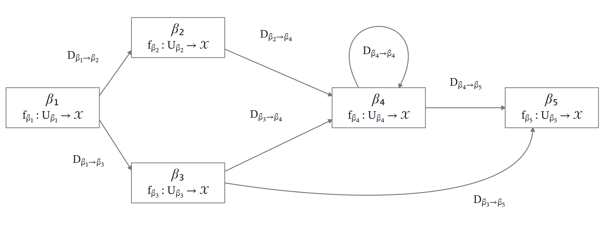

## 第 5 章 算子网络

连续复合与按域分段可以交错进行，使不同输入经过不同的局域作用。本章引入算子网络，明确每个输入的求值如何唯一终止，并把网络作用分解到各条实际路径上。在此基础上，将局部距离界与零化判据应用于实际发生域，并区分网络所表示的算子与实现它的节点、路径结构，研究保持外延的表示变换及前接算子形成的复合。

### 5.1 算子转移图与有限算子网络

在 [§ 4.4](<04-operator-chain-calculus.md#user-content-oet-e84832eedce36d68>) 的分段构造中，不同输入可以进入不同的局域算子。当各步输出继续参与后续作用时，我们还需记录局域算子之间的连接关系，以及哪些输出可以沿相应连接进入下一步。

同一点值可能出现在不同的计算位置，并在那里接受不同的后续作用。因此，我们用节点标记这些位置，将所在节点与当前点值共同记录为计算状态。下面先定义记录局域算子及其连接条件的算子转移图，再在此基础上定义有限算子网络。

**定义（算子转移图）**：一个有限**算子转移图** $\mathcal T$ 由以下数据构成。

**(i)** 给定有限有向图

$$
G_{\mathcal T}=(V_{\mathcal T},E_{\mathcal T}).
$$

**(ii)** 对每个节点 $\beta\in V_{\mathcal T}$，给定局域算子 $f_\beta\in\mathcal{X}_{\mathrm{op}}$，并要求其定义域非空。记

$$
U_\beta := \operatorname{dom}(f_\beta).
$$

不同节点的定义域可以重叠，局域算子在重叠处也可以取不同的值。

**(iii)** 对每条边 $(\beta,\gamma)\in E_{\mathcal T}$，给定非空转移域

$$
D_{\beta\to\gamma}\subseteq f_\beta(U_\beta)\cap U_\gamma,
$$

同一源节点的不同转移域可以相交。带节点标签的一步转移关系定义为：

$$
(\beta,x)\leadsto_{\mathcal T}(\gamma,y)
\quad\Longleftrightarrow\quad
(\beta,\gamma)\in E_{\mathcal T},\quad
x\in U_\beta,\quad y=f_\beta(x)\in D_{\beta\to\gamma}.
$$

**图 5.1（算子转移图的结构）**：节点携带局域算子，边携带转移域。分支、汇合与回边可以同时出现；每一步能否沿边继续，仍由局域输出是否落入该边的转移域决定。

**定义（转移图求值轨迹）**：设 $\mathcal{T}$ 为算子转移图，$\beta_1\in V_{\mathcal{T}}$，$x_1\in U_{\beta_1}$，且 $n\geq 1$。若序列

$$
\bigl((\beta_1,x_1),\ldots,(\beta_n,x_n)\bigr)\in (V_{\mathcal T}\times\mathcal{X})^n
$$

满足：对每个 $s=1,\ldots,n-1$，有 $(\beta_s,\beta_{s+1})\in E_{\mathcal{T}}$，且

$$
x_{s+1}=f_{\beta_s}(x_s)\in D_{\beta_s\to\beta_{s+1}},
$$

则称它为 $\mathcal{T}$ 中从 $(\beta_1,x_1)$ 开始的长度 $n$ 的**求值轨迹**。这里长度按节点发生次数计数；$n=1$ 时仅含初始状态，不含节点间转移。

底层图中的节点序列 $\beta_1\to\cdots\to\beta_n$ 只给出候选轨迹；它能否实际发生，还取决于各步输出是否落入对应的转移域。

**定义（终止域与终止求值轨迹）**：设 $\mathcal T$ 为算子转移图。对节点 $\beta\in V_{\mathcal T}$，记

$$
\mathrm{Succ}_{\mathcal T}(\beta)
=
\{\gamma\in V_{\mathcal T}:(\beta,\gamma)\in E_{\mathcal T}\},
$$

并定义 $\beta$ 的**终止域**

$$
T^{\mathcal T}_\beta
:=
f_\beta(U_\beta)
\setminus
\bigcup_{\gamma\in\mathrm{Succ}_{\mathcal T}(\beta)}D_{\beta\to\gamma}.
$$

终止域由不能沿任何出边继续的局域输出组成。若 $\mathrm{Succ}_{\mathcal T}(\beta)=\emptyset$，则 $T^{\mathcal T}_\beta=f_\beta(U_\beta)$。当 $\mathcal T$ 固定时，简记为 $T_\beta$。

若求值轨迹

$$
\bigl((\beta_1,x_1),\ldots,(\beta_n,x_n)\bigr)
$$

满足

$$
f_{\beta_n}(x_n)\in T^{\mathcal T}_{\beta_n},
$$

则称它为**终止求值轨迹**，其**终止输出**为 $f_{\beta_n}(x_n)$。算子转移图本身不要求从给定状态出发的后继唯一，也不要求求值过程必定终止。

**例（转移图中的求值）**：以带吸收元的实直线为底空间，取五个节点 $\beta_1,\ldots,\beta_5$。各局域算子的定义域均为 $\mathbb R$，作用公式与转移域标在下图中；边旁的条件均施加于源节点的输出 $y$。

**图 5.2（算子转移图中的求值）**：图中绘出从 $(\beta_1,1)$ 出发、沿 $\beta_3$ 到达 $\beta_4$ 后重复经过回边的一段轨迹。

在 $\beta_1$ 处，输出 $1$ 同时属于通往 $\beta_2$ 与 $\beta_3$ 的转移域，因而有两个合法后继。在 $\beta_4$ 处连续选择回边时，点值每次减 $1$，始终满足该边的转移条件，可以无限继续；当输出不大于 $0$ 时，也可以转入 $\beta_5$ 并终止。

**定义（有限算子网络）**：设 $U\subseteq\mathcal{X}$（按 [第 1 章](<01-foundations.md#user-content-oet-3ee3f54f03fccb92>) 的约定不含 $\bot$）。一个定义在 $U$ 上的**有限算子网络** $\mathcal{N}$ 是一个底层图为 $G=(V,E)$ 的有限算子转移图，加上入口节点集合 $V_{\mathrm{in}}\subseteq V$ 与入口输入片

$$
U_\beta^{\mathrm{in}}\subseteq U_\beta
\qquad(\beta\in V_{\mathrm{in}}),
$$

并满足以下四条条件。

**(i)（入口输入分划）**：对每个 $\beta\in V_{\mathrm{in}}$，$U_\beta^{\mathrm{in}}$ 非空，且

$$
U=\bigsqcup_{\beta\in V_{\mathrm{in}}}U_\beta^{\mathrm{in}}.
$$

**(ii)（出边转移域互斥）**：对每个节点 $\beta\in V$ 与任意两个不同后继 $\gamma_1\neq\gamma_2$，要求

$$
D_{\beta\to\gamma_1}\cap D_{\beta\to\gamma_2}=\emptyset.
$$

**(iii)（统一有限终止）**：存在 $N\in\mathbb N$，使每个 $x\in U$ 都有一条长度不超过 $N$ 的终止求值轨迹，其初始状态为 $(\beta,x)$，其中 $\beta$ 是满足 $x\in U_\beta^{\mathrm{in}}$ 的入口节点。

**(iv)（无冗余节点）**：对每个 $\beta\in V$，存在 $x\in U$，使从 $x$ 的入口状态出发的终止求值轨迹经过 $\beta$。

由 **(i)**，每个输入的入口节点唯一；由 **(ii)**，各步输出要么落入终止域，要么落入唯一出边的转移域。因此，同一输入的终止求值轨迹唯一。下文所说的输入 $x$ 的求值轨迹，均指这条完整的终止求值轨迹。

入口片 $U_\beta^{\mathrm{in}}$ 只规定初始输入的分配，可以是节点定义域 $U_\beta$ 的真子集。入口节点也可以有入边，从而既接收初始输入，也接收前序节点的输出。

条件 **(iii)** 要求所有输入共用一个有限长度界，逐点有限终止尚不足够。当 $U=\emptyset$ 时，由 **(i)**、**(iv)**，入口节点集与节点集均为空，因而边集也为空，各数据族均为空族。因此，空输入域上的网络唯一，称为**空网络**。下文将有限算子网络简称为**算子网络**。

**定义（网络外延算子与求值深度）**：设 $\mathcal N$ 为定义在 $U$ 上的算子网络。定义其**外延算子**

$$
\phi_{\mathcal N}(x):=
\begin{cases}
\text{输入 }x\text{ 的终止输出},&x\in U,\\
\bot,&x\notin U.
\end{cases}
$$

末端输入属于相应局域算子的定义域，因此终止输出不为 $\bot$，故 $\phi_{\mathcal N}\in\mathcal X_{\mathrm{op}}$，且 $\operatorname{dom}(\phi_{\mathcal N})=U$。域外输入不产生求值轨迹，$\bot$ 是对外延算子的补全。

当 $U\neq\emptyset$ 时，定义 $\mathcal N$ 的**求值深度**

$$
\operatorname{Depth}(\mathcal N)
:=
\max\{\,r:\text{存在 }x\in U\text{，其终止求值轨迹长度为 }r\,\}.
$$

统一有限长度界保证这个最大值存在；它也是最小的统一长度界。对空网络，约定 $\operatorname{Depth}(\mathcal N)=0$。

**例（同一底层图上的有限算子网络）**：保持前例的底层图与局域算子，按下图设置出边转移域，并取入口片

$$
U_{\beta_1}^{\mathrm{in}}=\{-2,-1,1,2\},\qquad
U_{\beta_4}^{\mathrm{in}}=\{3\}.
$$

它们分划输入域 $U=\{-2,-1,1,2,3\}$。节点 $\beta_4$ 既可接收初始输入，也可接收前序节点的输出。

**图 5.3（有限算子网络中的求值）**：图中绘出输入 $-2$ 的完整求值轨迹。同一节点可以重复经过，连续调用仍按点值与边域逐步判定。

各节点的出边转移域互斥。对上述五个输入逐步求值，轨迹长度依次为 $6,5,4,3,4$，且这些轨迹经过全部五个节点。因此，这组数据构成求值深度为 $6$ 的有限算子网络。图中的回边得以保留，而入口求值具有统一有限长度界。

**引理 5.1（删去冗余节点保持求值）**：设一组算子转移图与入口数据满足有限算子网络定义中的 **(i)**—**(iii)**。删除不被任何输入的终止求值轨迹经过的节点及其关联边，保留其余局域算子、转移域和入口片，则所得数据构成 $U$ 上的有限算子网络。每个输入的终止求值轨迹及其输出均保持不变，因而按上述方式定义的外延算子在删除前后相等。

**证明**：记原转移图为 $\mathcal T$，底层图为 $G=(V,E)$。取 **(iii)** 中的统一长度界 $N$，将输入 $x\in U$ 的唯一终止求值轨迹记为

$$
\tau_x=\bigl((\beta_1(x),x_1(x)),\ldots,(\beta_{n(x)}(x),x_{n(x)}(x))\bigr),
\qquad n(x)\le N.
$$

令

$$
R:=\{\beta_s(x):x\in U,\ 1\le s\le n(x)\},
\qquad E_R:=E\cap(R\times R).
$$

在诱导子图 $G_R=(R,E_R)$ 上保留原局域算子与转移域，得到 $\mathcal T_R$。由各入口片非空，$V_{\mathrm{in}}\subseteq R$，故入口分划不变；保留的转移域仍满足包含关系与出边互斥条件。因此 **(i)**、**(ii)** 仍成立。

对 $x\in U$，$\tau_x$ 的每个节点均属于 $R$，故每次转移所用的边都属于 $E_R$，相应转移域未变。另一方面，对任意 $\beta\in R$，

$$
T_\beta^{\mathcal T_R}
=f_\beta(U_\beta)\setminus
\bigcup_{\gamma\in\mathrm{Succ}_{\mathcal T}(\beta)\cap R}D_{\beta\to\gamma}
\supseteq T_\beta^{\mathcal T}.
$$

因此 $\tau_x$ 的末端输出仍落入终止域。由入口与后继的唯一性，删除后输入 $x$ 的终止求值轨迹 $\tau_x^R$ 满足

$$
\tau_x^R=\tau_x,\qquad |\tau_x^R|=n(x)\le N.
$$

这给出 **(iii)**；按 $R$ 的定义及上述轨迹等式，**(iv)** 也成立，故所得数据构成有限算子网络。

记删除前后的外延算子分别为 $\phi$ 与 $\phi_R$。轨迹与局域算子均保持不变，故

$$
\phi_R(x)=\phi(x)\quad(x\in U),
\qquad
\phi_R(x)=\phi(x)=\bot\quad(x\notin U).
$$

于是 $\phi_R=\phi$。$\square$

### 5.2 网络对象空间与外延读出

为了在网络之间定义读出、伪度量与商，先将有限网络统一编码，并据此构造网络对象空间。

**引理 5.2（有限网络的编号编码）**：设 $\mathcal N$ 为节点集 $V$ 有限的算子网络。令 $n=|V|$，并记

$$
[n]=\{0,\ldots,n-1\},\qquad [0]=\emptyset.
$$

给定双射 $e:V\to[n]$，将节点、边、局域算子、入口片和转移域统一重编号：

$$
\widetilde f_{e(\beta)}=f_\beta,\qquad
\widetilde U_{e(\beta)}^{\mathrm{in}}=U_\beta^{\mathrm{in}},\qquad
\widetilde D_{e(\beta)\to e(\gamma)}=D_{\beta\to\gamma}.
$$

所得 $\widetilde{\mathcal N}$ 是同一输入域 $U$ 上、节点集为 $[n]$ 的有限算子网络。每个输入的中间点与终端输出不变，路径标签逐项经 $e$ 变换；相应路径域相同，求值深度相同，并且

$$
\phi_{\widetilde{\mathcal N}}=\phi_{\mathcal N}.
$$

重编号保留节点共享：两个发生原来具有相同节点标签，当且仅当重编号后具有相同标签。

**证明**：取双射 $e:V\to[n]$。若原边集为 $E$，则重编号后的边集为 $\widetilde E=\{(e(\beta),e(\gamma)):(\beta,\gamma)\in E\}$，入口集为 $\widetilde V_{\mathrm{in}}=e(V_{\mathrm{in}})$。各入口片与转移域仅更换下标，故入口分划、转移域包含关系及出边互斥条件保持。

定义状态之间的双射

$$
\widehat e:V\times\mathcal X\longrightarrow[n]\times\mathcal X,
\qquad \widehat e(\beta,y)=(e(\beta),y).
$$

由 $\widetilde f_{e(\beta)}=f_\beta$ 与 $\widetilde D_{e(\beta)\to e(\gamma)}=D_{\beta\to\gamma}$，单步转移满足

$$
(\beta,y)\leadsto_{\mathcal N}(\gamma,z)
\quad\Longleftrightarrow\quad
\widehat e(\beta,y)\leadsto_{\widetilde{\mathcal N}}\widehat e(\gamma,z).
$$

在终止域公式中将后继节点按 $e$ 换元，得到

$$
T_{e(\beta)}^{\widetilde{\mathcal N}}
=f_\beta(U_\beta)\setminus
\bigcup_{\gamma\in\mathrm{Succ}_{\mathcal N}(\beta)}D_{\beta\to\gamma}
=T_\beta^{\mathcal N}.
$$

因此，对每个 $x\in U$，逐步应用单步转移的等价关系及终止域等式，原终止求值轨迹与重编号后的轨迹对应为

$$
\begin{aligned}
\tau_x&=\bigl((\beta_1,x_1),\ldots,(\beta_r,x_r)\bigr),\\
\widetilde\tau_x&=\bigl((e(\beta_1),x_1),\ldots,(e(\beta_r),x_r)\bigr).
\end{aligned}
$$

反向沿 $e^{-1}$ 得到逆对应。于是 $|\widetilde\tau_x|=|\tau_x|$，原统一长度界仍适用；每个新节点 $e(\beta)$ 也被原来经过 $\beta$ 的输入轨迹访问，故无冗余节点条件保持。由此，$\widetilde{\mathcal N}$ 是有限算子网络。上述对应保留初始输入，故每条路径与其重编号路径具有同一输入域。

当 $U\neq\emptyset$ 时，取轨迹长度的最大值；当 $U=\emptyset$ 时，两侧深度均为 $0$。又因各中间点及末端局域算子的输出不变，域外两侧均取 $\bot$，可得

$$
\operatorname{Depth}(\widetilde{\mathcal N})=\operatorname{Depth}(\mathcal N),
\qquad
\phi_{\widetilde{\mathcal N}}=\phi_{\mathcal N}.
$$

最后，由 $e$ 的单射性，

$$
e(\beta)=e(\gamma)\quad\Longleftrightarrow\quad\beta=\gamma,
$$

故节点共享关系保持。$\square$

**引理 5.3（有限编号网络构成集合）**：对给定底集 $\mathcal X$，节点集为某个 $[n]$（$n\in\mathbb N$）、输入域非空的所有有限算子网络，连同唯一空网络，构成一个集合。该集合在配备扩展规范结构后，可再次作为算子空间或网络对象空间构造的底集。

**证明**：固定 $n$ 后，边集属于 $\mathcal P([n]\times[n])$，节点算子族属于 $(\mathcal X_{\mathrm{op}})^{[n]}$，入口片与边域族分别属于 $\mathcal P(\mathcal X)^{[n]}$ 与 $\mathcal P(\mathcal X)^{[n]\times[n]}$，输入域属于 $\mathcal P(\mathcal X)$。这些都是集合，满足网络条件的数据组成其有限乘积的子集。对 $n\in\mathbb N$ 取不交并，再加入一个空网络，仍为集合。同一论证适用于任何给定底集，因而也适用于上述集合。$\square$

**定义（算子网络对象空间）**：称 [引理 5.3](<#user-content-oet-038163ee6fa2eddc>) 中的集合为 $\mathcal X$ 上的**算子网络对象空间**，记为 $\mathcal X_{\mathrm{net}}$。

任意有限标签网络进入该对象空间前，须给定 [引理 5.2](<#user-content-oet-b2fb8267687c8372>) 中的编号编码。具体计算仍可使用原标签，并保留它与编号之间的双射。

这一约定不对网络取同构商。不同编号给出的数据仍分别作为对象，只有数据本身相同时才是同一对象；节点共享始终由同一网络内的标签相等关系记录。域加细、代数加细、前缀扩展或无环展开若先用有限乘积、不交并或发生位置作标签，则在作为对象空间元素使用时再作编号编码。

空网络记为

$$
\bot_{\mathrm{net}}.
$$

其输入域、节点集、入口节点集均为空，外延算子为全未定义算子：

$$
\phi_{\bot_{\mathrm{net}}}=\bot_{\mathrm{op}}.
$$

除 $\bot_{\mathrm{net}}$ 外，$\mathcal{X}_{\mathrm{net}}$ 中的每个网络对象均按本章定义具有非空输入域。因而若 $\mathcal N\neq\bot_{\mathrm{net}}$，则 $\mathrm{dom}(\phi_{\mathcal N})\neq\emptyset$。

后文凡对网络输入域使用局部等价记号 $\equiv_U$，均默认 $U\neq\emptyset$；空网络只对应 $\bot_{\mathrm{op}}$，其外延关系按 $\mathcal{X}_{\mathrm{op}}$ 中的等式理解。

**定义（网络读出映射）**：设 $A\subseteq\mathcal{X}_{\mathrm{net}}$，$P$ 为集合。一个映射

$$
\Gamma:A\to P
$$

称为 $A$ 上的**网络读出映射**。它只把网络对象送到某类指定数据，不要求由该数据恢复网络对象。当 $A=\mathcal{X}_{\mathrm{net}}$ 时，称为全网络对象空间上的网络读出映射。

若 $P$ 带有限分量伪度量族 $\mathcal G_P$，则称 $(P,\mathcal G_P,\Gamma)$ 为一个**规范网络读出**。

**定义（算子读出映射）**：对每个 $\mathcal N\in\mathcal X_{\mathrm{net}}$，记其外延算子为 $\phi_{\mathcal N}$。称映射

$$
\Gamma_{\mathrm{op}}
:\mathcal{X}_{\mathrm{net}}\longrightarrow\mathcal{X}_{\mathrm{op}},
\qquad
\mathcal N\longmapsto\phi_{\mathcal N}
$$

为**算子读出映射**。

若网络读出映射 $\Gamma:A\to P$ 满足对任意 $\mathcal N_1,\mathcal N_2\in A$，

$$
\Gamma_{\mathrm{op}}(\mathcal N_1)=\Gamma_{\mathrm{op}}(\mathcal N_2)
\quad\Longrightarrow\quad
\Gamma(\mathcal N_1)=\Gamma(\mathcal N_2),
$$

则称 $\Gamma$ 为**外延不变读出**。此时 $\Gamma$ 只依赖网络对象的算子读出值。若该条件不成立，则 $\Gamma$ 是表示层读出，只能与具体网络对象一起使用。

算子读出 $\Gamma_{\mathrm{op}}$ 本身是外延不变读出。

对每个 $i\in I$，定义 $\mathcal{X}_{\mathrm{net}}$ 上的**外延网络伪度量**

$$
d_{\mathrm{net},i}^{\mathrm{op}}(\mathcal N_1,\mathcal N_2)
:=
d_{\mathrm{op},i}(\phi_{\mathcal N_1},\phi_{\mathcal N_2}).
$$

记

$$
\mathcal{G}_{\mathrm{net}}^{\mathrm{op}}
=
\{d_{\mathrm{net},i}^{\mathrm{op}}\}_{i\in I}.
$$

**命题 5.4（有限算子网络的外延规范空间）**：$(\mathcal{X}_{\mathrm{net}},\mathcal{G}_{\mathrm{net}}^{\mathrm{op}},\bot_{\mathrm{net}})$ 构成扩展规范空间。

**证明**：对每个 $i\in I$，$d_{\mathrm{net},i}^{\mathrm{op}}$ 是 $d_{\mathrm{op},i}$ 沿算子读出 $\Gamma_{\mathrm{op}}$ 的拉回，因此自距零、对称性和三角不等式由 $d_{\mathrm{op},i}$ 逐项继承。

若 $\mathcal N\neq\bot_{\mathrm{net}}$，则 $\mathcal N$ 的输入域非空，故

$$
\mathrm{dom}(\phi_{\mathcal N})\neq\emptyset.
$$

而 $\phi_{\bot_{\mathrm{net}}}=\bot_{\mathrm{op}}$。由 [命题 1.2](<01-foundations.md#user-content-oet-91e0e3c458eb7786>) 中算子规范空间的吸收元隔离性，

$$
d_{\mathrm{op},i}(\phi_{\mathcal N},\bot_{\mathrm{op}})=+\infty,
$$

从而

$$
d_{\mathrm{net},i}^{\mathrm{op}}(\mathcal N,\bot_{\mathrm{net}})=+\infty.
$$

另一方面，由扩展规范空间公理取 $z\neq\bot$。取入口域为 $\{z\}$、局域算子为 $\mathrm{id}_{\mathcal X}$ 的单节点网络，得到一个不同于 $\bot_{\mathrm{net}}$ 的网络对象，故非吸收元部分非空。于是 $\mathcal{G}_{\mathrm{net}}^{\mathrm{op}}$ 满足扩展规范空间公理。$\square$

> **注（外延网络伪度量的分辨范围）**：外延网络伪度量只比较 $\phi_{\mathcal N_1}$ 与 $\phi_{\mathcal N_2}$。有效结构、路径结构与节点共享关系属于表示层信息，不由 $\mathcal{G}_{\mathrm{net}}^{\mathrm{op}}$ 读取。

**命题 5.5（外延商与算子空间）**：在 $\mathcal{X}_{\mathrm{net}}$ 上定义关系

$$
\mathcal N_1\sim_{\mathrm{op}}\mathcal N_2
\quad\Longleftrightarrow\quad
\phi_{\mathcal N_1}=\phi_{\mathcal N_2}.
$$

则 $\sim_{\mathrm{op}}$ 是等价关系。记 $[\mathcal N]$ 为 $\mathcal N$ 关于 $\sim_{\mathrm{op}}$ 的等价类，则 $\Gamma_{\mathrm{op}}$ 诱导双射

$$
\overline{\Gamma}_{\mathrm{op}}:
\mathcal{X}_{\mathrm{net}}/{\sim_{\mathrm{op}}}
\longrightarrow
\mathcal{X}_{\mathrm{op}}.
$$

此外，对任意代表元 $\mathcal N_1,\mathcal N_2$ 与任意 $i\in I$，

$$
d_{\mathrm{net},i}^{\mathrm{op}}(\mathcal N_1,\mathcal N_2)
=
d_{\mathrm{op},i}
\bigl(
\overline{\Gamma}_{\mathrm{op}}([\mathcal N_1]),
\overline{\Gamma}_{\mathrm{op}}([\mathcal N_2])
\bigr).
$$

**证明**：$\sim_{\mathrm{op}}$ 是等价关系，因为它是映射

$$
\mathcal N\mapsto\phi_{\mathcal N}
$$

的纤维关系。算子读出 $\Gamma_{\mathrm{op}}$ 在商集上给出良定义映射 $\overline{\Gamma}_{\mathrm{op}}$。该映射单射由商关系定义直接得到。

下面证明满射。对 $\bot_{\mathrm{op}}$，空网络 $\bot_{\mathrm{net}}$ 满足 $\phi_{\bot_{\mathrm{net}}}=\bot_{\mathrm{op}}$。

对任意 $\phi\in\mathcal{X}_{\mathrm{op}}$ 且 $\phi\neq\bot_{\mathrm{op}}$，取

$$
U=\operatorname{dom}(\phi).
$$

构造单节点网络：节点集为 $\{\beta\}$，无边，入口节点为 $\beta$，入口输入片 $U_\beta^{\mathrm{in}}=U$，局域算子 $f_\beta=\phi$。该网络的外延算子等于 $\phi$。故 $\Gamma_{\mathrm{op}}$ 满射，进而 $\overline{\Gamma}_{\mathrm{op}}$ 为双射。

最后一个等式由 $d_{\mathrm{net},i}^{\mathrm{op}}$ 的定义和 $\overline{\Gamma}_{\mathrm{op}}([\mathcal N_a])=\phi_{\mathcal N_a}$（$a=1,2$）直接给出。$\square$

上述外延商也可用于其他外延不变读出。

**推论 5.6（外延不变读出的商因子化）**：设 $A\subseteq\mathcal X_{\mathrm{net}}$，$\Gamma:A\to P$ 为外延不变读出，$\pi:A\to A/{\sim_{\mathrm{op}}}$ 为限制等价关系的商映射。则存在唯一映射 $\overline\Gamma:A/{\sim_{\mathrm{op}}}\to P$，使

$$
\Gamma=\overline\Gamma\circ\pi.
$$

**证明**：对 $\mathcal N\in A$，以 $[\mathcal N]_A=[\mathcal N]\cap A$ 记其在 $A$ 中的等价类，定义 $\overline\Gamma([\mathcal N]_A)=\Gamma(\mathcal N)$。外延不变性保证该值与代表元选择无关，并给出所需等式；唯一性由 $\pi$ 的满射性得到。$\square$

> **注（外延相等与零距离）**：外延相等必然使所有分量的外延网络伪度量为零，但零距离一般不能反推出外延算子相等。上述外延商按算子相等划分等价类；零距离商则可能进一步合并不同的外延算子。

**定义（网络表示）**：设 $\phi \in \mathcal{X}_{\mathrm{op}}$，$\emptyset\neq U \subseteq \mathrm{dom}(\phi)$。若输入域为 $U$ 的算子网络 $\mathcal{N}$ 的外延算子 $\phi_{\mathcal{N}}$ 满足

$$
\phi_{\mathcal{N}} \equiv_U \phi,
$$

则称 $\mathcal{N}$ 是 $\phi$ 在 $U$ 上的一个网络表示。这里 $\equiv_U$ 为 [§ 4.5](<04-operator-chain-calculus.md#user-content-oet-a1caa879309ff2e3>) 中的局部等价关系。网络表示不声明唯一性。

> **注（节点数不是外延不变量）**：存在外延算子相同但节点数不同的有限算子网络。
>
> **证明**：取 $\mathcal X=\{\bot,a\}$，其中 $a\ne\bot$，并令两网的输入域均为 $U=\{a\}$。
>
> 单节点网络 $\mathcal N_1$ 取 $V_1=\{\beta\}$、$E_1=\emptyset$，唯一节点 $\beta$ 为入口，且
>
> $$
> f_\beta=\mathrm{id}_{\mathcal X},
> \qquad U_\beta^{\mathrm{in}}=\{a\}.
> $$
>
> 二节点网络 $\mathcal N_2$ 取两个不同节点 $V_2=\{\beta_1,\beta_2\}$、唯一边 $E_2=\{(\beta_1,\beta_2)\}$，唯一入口为 $\beta_1$，且
>
> $$
> f_{\beta_1}=f_{\beta_2}=\mathrm{id}_{\mathcal X},
> \qquad U_{\beta_1}^{\mathrm{in}}=\{a\},
> \qquad D_{\beta_1\to\beta_2}=\{a\}.
> $$
>
> 输入 $a$ 在两网中的求值轨迹均唯一终止，长度分别为 $1$ 与 $2$，并经过各自的全部节点，故两者均为有限算子网络。对任意 $x\in\mathcal X$，
>
> $$
> \phi_{\mathcal N_1}(x)=\phi_{\mathcal N_2}(x)
> =\begin{cases}
> a,&x=a,\\
> \bot,&x=\bot,
> \end{cases}
> =\mathrm{id}_{\mathcal X}(x).
> $$
>
> 但 $|V_1|=1$、$|V_2|=2$，故节点数不能由外延算子唯一决定。$\square$

### 5.3 路径分解与前缀发生

设 $\mathcal N\in\mathcal X_{\mathrm{net}}$，其输入域为 $U$。对 $x\in U$，由有限算子网络定义得到唯一有限终止轨迹，记其节点标签序列为**路径映射**

$$
p_{\mathcal{N}}(x)=(\beta_1,\ldots,\beta_r).
$$

固定网络 $\mathcal{N}$ 时，简写为 $p(x)$。称 $p_{\mathcal{N}}(x)$ 为 $x$ 的**网络路径**。对应**路径链**为

$$
c_{p(x)}=f_{\beta_r}\circ\cdots\circ f_{\beta_1}.
$$

对任意有限节点序列 $p=(\beta_1,\ldots,\beta_r)$，定义**路径域**

$$
U^{\mathcal{N}}_p=\{x\in U:p_{\mathcal{N}}(x)=p\}.
$$

固定 $\mathcal{N}$ 时，简写为 $U_p$。

定义**可达路径集**

$$
\mathcal{P}(\mathcal{N})=\{p:U_p\neq\emptyset\}.
$$

将 [图 5.3](<#user-content-oet-55d2487a68b2728e>) 中输入 $-2$ 对应的路径展开，可直接看出网络节点与路径链中各次调用的对应关系。

**图 5.4（从网络路径到算子链）**：上方标出输入 $-2$ 在网络中经过的节点和边，下方按调用次序展开为算子链，箭头旁标出传递的点值。节点 $\beta_4$ 在网络中只有一个，在这条路径中被调用三次；路径链的复合表达式按算子作用顺序从右向左书写。

**命题 5.7（路径分解与可达路径有限性）**：

**(i)（路径分解）** $\{U_p\}_{p\in\mathcal{P}(\mathcal{N})}$ 构成 $U$ 的分划，且对任意 $x\in U$，

$$
\phi_{\mathcal{N}}(x)=c_{p(x)}(x).
$$

当 $U=\emptyset$ 时，可达路径族为空；这里将空族视为空集的分划。

**(ii)（可达路径族有限性）** 设 $n=|V|$。则 $\mathcal{P}(\mathcal{N})$ 为有限集，且

$$
|\mathcal{P}(\mathcal{N})|
\leq
\sum_{r=1}^{\operatorname{Depth}(\mathcal N)} n^r .
$$

空网络满足 $n=\operatorname{Depth}(\mathcal N)=0$，此时右侧为空和，取值为 $0$。

**证明**：

**(i)** 由有限算子网络定义，每个 $x\in U$ 存在唯一终止轨迹，其节点标签序列有限，记为 $p(x)$。路径域是映射

$$
x\mapsto p(x)
$$

的非空原像族，因此两两不交并覆盖 $U$。若 $p(x)=(\beta_1,\ldots,\beta_r)$，求值定义逐步给出

$$
\phi_{\mathcal{N}}(x)=f_{\beta_r}(\cdots f_{\beta_1}(x)\cdots)=c_{p(x)}(x).
$$

**(ii)** 由求值深度定义，每条可达路径长度不超过 $\operatorname{Depth}(\mathcal N)$。长度为 $r$ 的节点序列数至多为 $n^r$，因此可达路径数不超过所有长度 $1\leq r\leq\operatorname{Depth}(\mathcal N)$ 的节点序列总数。若 $n=0$，则只能是空网络，路径族为空，右侧空和为 $0$。$\square$

**定义（路径分段表达与读出）**：$\mathcal{N}$ 在 $U$ 上的**路径分段表达**定义为

$$
\Gamma_{\mathrm{path}}(\mathcal N)
:=
\left\{
U_p:c_p
\right\}_{p\in\mathcal{P}(\mathcal{N})}.
$$

这里的下标 $p$ 只用于枚举路径片，不作为表达的数据保留；表达记录各路径域及其复合算子，不记录节点标签序列。以 $\mathcal X_{\mathrm{net}}$ 为定义域、全部路径分段表达构成的集合为值域，映射 $\mathcal N\mapsto\Gamma_{\mathrm{path}}(\mathcal N)$ 称为**路径分段读出**。遗忘分段结构后得到外延算子在 $U$ 上的限制；再连同域外取吸收元的约定，得到算子读出 $\Gamma_{\mathrm{op}}$。

> **注（路径分段表达与分段算子）**：当 $U\ne\varnothing$ 时，[命题 5.7](<#user-content-oet-56edb9917107efcd>)(i) 表明 $\phi_{\mathcal{N}}$ 在 $U$ 上局部等价于路径分段表达 $\Gamma_{\mathrm{path}}(\mathcal N)$ 所给出的分段算子。路径内部由 [第 4 章](<04-operator-chain-calculus.md#user-content-oet-733643513b9e4f98>) 的链代数处理；路径之间的比较由 [§ 4.4](<04-operator-chain-calculus.md#user-content-oet-e84832eedce36d68>) 的分段算子工具处理。

为记录路径中的中间调用，下面引入可达路径前缀及其对应的输入、输出域。

**定义（可达前缀与发生域）**：有限算子网络 $\mathcal N$ 的**可达路径前缀集**为

$$
\operatorname{Pref}(\mathcal N)
:=
\{q:q\text{ 是某条 }p\in\mathcal P(\mathcal N)\text{ 的非空前缀}\}.
$$

可达路径有限且各自长度有限，故该集合有限。同一节点可以在一个前缀中重复出现。

对 $q=(\beta_1,\ldots,\beta_s)\in\operatorname{Pref}(\mathcal N)$，记以 $q$ 为前缀的完整路径族及其初始输入集合为

$$
\mathcal P[q\ast]
:=
\{p\in\mathcal P(\mathcal N):p\text{ 以 }q\text{ 为前缀}\},
\qquad
U[q\ast]:=\bigcup_{p\in\mathcal P[q\ast]}U_p.
$$

方括号表示路径筛选，$\ast$ 表示任意有限节点序列，允许为空。记 $c_q=f_{\beta_s}\circ\cdots\circ f_{\beta_1}$。该前缀发生的**当前输入域**与**当前输出域**分别为

$$
D_q^{\mathrm{in}}
:=
\begin{cases}
U[q\ast], & s=1,\\
(f_{\beta_{s-1}}\circ\cdots\circ f_{\beta_1})(U[q\ast]), & s\ge2,
\end{cases}
\qquad
D_q^{\mathrm{in}}\subseteq U_{\beta_s},
$$

$$
D_q^{\mathrm{out}}
:=f_{\beta_s}(D_q^{\mathrm{in}})
=c_q(U[q\ast]).
$$

$U[q\ast]$ 记录产生该前缀的初始输入，$D_q^{\mathrm{in}}$ 与 $D_q^{\mathrm{out}}$ 记录末节点作用前后的点值。同一节点在不同前缀中出现时，对应的当前输入、输出域可以不同。

> **注（节点标签与身份）**：在网络表示中，求值状态由当前节点和当前点共同决定，而不是由点值 $y\in\mathcal{X}$ 单独决定。节点身份由网络结构中的顶点给出；共享局部计算应在网络数据中表现为同一个顶点被多条路径经过。

由 [§ 5.1](<#user-content-oet-86752cb60c8e01e3>) 的无冗余节点条件，每个节点 $\beta\in V$ 都出现在某条 $p\in\mathcal{P}(\mathcal{N})$ 中。节点层面的数据以 $V$ 为索引；同一节点的不同路径发生则由相应的可达前缀区分。

### 5.4 有效约化与有效等价

沿各条可达路径收集节点的实际输入，可以把局域算子限制到求值真正使用的区域。节点 $\beta$ 的实际输入集合由所有到达它的前缀的当前输入域取并得到。

**定义（节点实际输入域）**：设 $\mathcal N$ 为算子网络。对节点 $\beta\in V$，定义

$$
U_\beta^{\mathrm{eff}}
:=
\bigcup_{\substack{q=(\beta_1,\ldots,\beta_s)\in\operatorname{Pref}(\mathcal N)\\\beta_s=\beta}}
D_q^{\mathrm{in}}.
$$

上标 $\mathrm{eff}$ 表示网络从输入域 $U$ 出发实际到达或实际使用的有效层数据。

由无冗余节点约定，$U_\beta^{\mathrm{eff}}\neq\emptyset$，且

$$
U_\beta^{\mathrm{eff}}\subseteq U_\beta=\operatorname{dom}(f_\beta).
$$

节点算子在 $U_\beta\setminus U_\beta^{\mathrm{eff}}$ 上的取值不会被网络从输入域 $U$ 出发的任何求值过程调用。

**定义（有效约化网络）**：$\mathcal{N}$ 的**有效约化** $\mathcal{N}^{\mathrm{eff}}$ 是按如下方式得到的网络：保留节点集，将节点 $\beta$ 的局域算子替换为限制算子

$$
f_\beta^{\mathrm{eff}}
=
f_\beta\big|_{U_\beta^{\mathrm{eff}}},
\qquad
\operatorname{dom}(f_\beta^{\mathrm{eff}})=U_\beta^{\mathrm{eff}}.
$$

入口节点集合不变，入口输入片取

$$
U_\beta^{\mathrm{in},\mathrm{eff}}=U_\beta^{\mathrm{in}}
\qquad(\beta\in V_{\mathrm{in}}).
$$

将原边域与终止域限制到节点实际产生的输出上，得到**有效边域**与**有效终止域**：

$$
D_{\beta\to\gamma}^{\mathrm{eff}}
:=f_\beta(U_\beta^{\mathrm{eff}})\cap D_{\beta\to\gamma}
\qquad((\beta,\gamma)\in E),
$$

$$
T_\beta^{\mathrm{eff}}
:=f_\beta(U_\beta^{\mathrm{eff}})\cap T_\beta.
$$

若有效边域为空，则不记录该边。

**命题 5.8（有效约化保持外延）**：对任意定义在非空输入域 $U$ 上的算子网络 $\mathcal{N}$，上述有效约化数据构成同一输入域上的有限算子网络 $\mathcal N^{\mathrm{eff}}$，且

$$
\phi_{\mathcal{N}^{\mathrm{eff}}}\equiv_U\phi_{\mathcal{N}}.
$$

**证明**：先核对局域算子与转移域。由 $U_\beta^{\mathrm{eff}}\neq\emptyset$，$f_\beta^{\mathrm{eff}}\in\mathcal{X}_{\mathrm{op}}$ 且

$$
\operatorname{dom}(f_\beta^{\mathrm{eff}})=U_\beta^{\mathrm{eff}}.
$$

入口输入片满足 $U_\beta^{\mathrm{in},\mathrm{eff}}\subseteq U_\beta^{\mathrm{eff}}$。对有效边 $(\beta,\gamma)$，有

$$
D_{\beta\to\gamma}^{\mathrm{eff}}
\subseteq
f_\beta^{\mathrm{eff}}(U_\beta^{\mathrm{eff}})
\cap
U_\gamma^{\mathrm{eff}}.
$$

若 $y\in f_\beta(U_\beta^{\mathrm{eff}})$，则某个初始输入的求值轨迹在节点 $\beta$ 实际产生输出 $y$。当 $y\in D_{\beta\to\gamma}$ 时，该轨迹下一步进入 $\gamma$；当 $y\in T_\beta$ 时，该轨迹在 $\beta$ 终止。反之，实际经过该边或在该节点终止的输出都属于相应交集。因此，上述有效边域与有效终止域恰好记录实际经过的边输出与终止输出。

由原网络的出边互斥性与终止域定义，这些域两两不交，且

$$
f_\beta^{\mathrm{eff}}(U_\beta^{\mathrm{eff}})
=
T_\beta^{\mathrm{eff}}
\sqcup
\bigsqcup_{\gamma\in\mathrm{Succ}(\beta)}
D_{\beta\to\gamma}^{\mathrm{eff}},
$$

其中空有效边域不记录为边。

取任意 $x\in U$，设其在 $\mathcal{N}$ 中的路径为

$$
p(x)=(\beta_1,\ldots,\beta_r).
$$

对每个 $s$，第 $s$ 步当前输入属于对应前缀发生的 $D_q^{\mathrm{in}}$，因而属于 $U_{\beta_s}^{\mathrm{eff}}$。有效约化在该点上使用的限制算子与原 $f_{\beta_s}$ 取值相同。

原路径中实际经过的边输出属于对应的 $D_{\beta_s\to\beta_{s+1}}^{\mathrm{eff}}$；最终输出属于 $T_{\beta_r}^{\mathrm{eff}}$。故 $\mathcal{N}^{\mathrm{eff}}$ 对 $x$ 经过同一节点序列并得到同一输出。

原统一长度界与无冗余节点条件因此仍然成立，故上述数据满足有限算子网络的全部条件。又因每个输入的输出相同，两者外延算子在 $U$ 上局部等价。$\square$

路径分段表达只记录各路径域及相应的复合算子。若进一步保留各路径中有序的节点标签与局域算子因子，则可恢复有效网络的分段结构。

**定义（标记分段算子表达与读出）**：$\mathcal{N}$ 在 $U$ 上的**标记分段算子表达**为路径域分划下的有序标记因子族

$$
\Gamma_{\mathrm{tag}}(\mathcal N)
:=
\left\{
U_p:
\bigl((\beta_1,f_{\beta_1}),\ldots,(\beta_r,f_{\beta_r})\bigr)
\right\}_{p=(\beta_1,\ldots,\beta_r)\in\mathcal{P}(\mathcal{N})}.
$$

每个有序对 $(\beta_n,f_{\beta_n})$ 同时记录第 $n$ 个因子的节点身份与局域算子。标签不参与函数求值；标签相同表示对应因子来自同一个节点，标签不同则即使两个局域算子外延相同，也不视为同一个节点。对每个路径片按顺序复合所记录的局域算子，并遗忘因子标签，便得到 $\Gamma_{\mathrm{path}}(\mathcal N)$。

以 $\mathcal X_{\mathrm{net}}$ 为定义域、全部标记分段算子表达构成的集合为值域，映射 $\mathcal N\mapsto\Gamma_{\mathrm{tag}}(\mathcal N)$ 称为**标记分段读出**。逐片求取有序因子复合并遗忘因子标签，得到路径分段读出；再遗忘分段结构并按域外吸收元约定求值，得到算子读出：

$$
\Gamma_{\mathrm{tag}}
\longrightarrow
\Gamma_{\mathrm{path}}
\longrightarrow
\Gamma_{\mathrm{op}}.
$$

> **注（路径分段不由外延决定）**：存在外延算子相同而路径分段读出不同的有限算子网络，因而标记分段读出也一般不由外延算子决定。
>
> **证明**：取 $\mathcal X=\{\bot,a,b\}$，其中三点互异，并令输入域为 $U=\{a,b\}$。单节点网络 $\mathcal N_1$ 的局域算子为 $\mathrm{id}_{\mathcal X}$，入口片为 $U$，无边。网络 $\mathcal N_2$ 取两个无边的入口节点，局域算子均为 $\mathrm{id}_{\mathcal X}$，入口片分别为 $\{a\}$ 与 $\{b\}$。两网的每个输入均经一步终止，各节点均被经过，且外延算子都是 $\mathrm{id}_{\mathcal X}$。但
>
> $$
> \Gamma_{\mathrm{path}}(\mathcal N_1)=\{U:\mathrm{id}_{\mathcal X}\},
> \qquad
> \Gamma_{\mathrm{path}}(\mathcal N_2)=\{\{a\}:\mathrm{id}_{\mathcal X},\ \{b\}:\mathrm{id}_{\mathcal X}\}.
> $$
>
> 两者的路径域分划不同，故路径分段读出不同。若标记分段读出相同，遗忘标签并逐片复合后，路径分段读出也应相同，矛盾。$\square$

当若干因子具有同一标签时，它们记录同一个节点算子。标记分段算子表达的同构必须同时保持路径域分划、各片内因子顺序、因子标签、各因子在相应实际输入域上的局部等价关系，以及同标签因子的共享关系。

**命题 5.9（标记分段算子表达决定有效网络）**：标记分段算子表达 $\Gamma_{\mathrm{tag}}(\mathcal N)$ 决定 $\mathcal{N}^{\mathrm{eff}}$ 的节点实际输入域、入口输入片、有效边域、有效终止域与外延算子，至多差一个节点重命名。

**证明**：对路径 $p=(p_1,\ldots,p_{|p|})$，在本证明中记

$$
c_{p,n}:=f_{p_n}\circ\cdots\circ f_{p_1},\qquad
c_{p,0}:=\mathrm{id}.
$$

有效节点由因子标签给出。由于有序因子列被保留，每个前缀复合 $c_{p,n}$ 均由表达本身确定。若标签 $\beta$ 对应有效节点，则其实际输入域由

$$
U_\beta^{\mathrm{eff}}
=
\bigcup_{\substack{p\in\mathcal{P}(\mathcal{N}),\ 1\leq n\leq |p|\\ p_n=\beta}}
c_{p,n-1}(U_p)
$$

给出，对应有效节点算子为 $f_\beta|_{U_\beta^{\mathrm{eff}}}$。对入口标签 $\beta$，入口输入片由路径首位给出：

$$
U_\beta^{\mathrm{in},\mathrm{eff}}
=
\bigcup_{\substack{p\in\mathcal{P}(\mathcal{N})\\ p_1=\beta}}
U_p
$$

对所有相邻因子标签为 $\beta,\gamma$ 的路径取并，得到对应有效边域

$$
D_{\beta\to\gamma}^{\mathrm{eff}}
=
\bigcup_{\substack{p\in\mathcal{P}(\mathcal{N}),\ 1\leq n<|p|\\
p_n=\beta,\ p_{n+1}=\gamma}}
c_{p,n}(U_p).
$$

对终止标签 $\beta$，终止域由路径末位给出：

$$
T_\beta^{\mathrm{eff}}
=
\bigcup_{\substack{p\in\mathcal{P}(\mathcal{N})\\ p_{|p|}=\beta}}
c_p(U_p).
$$

外延算子由路径分段表达

$$
\Gamma_{\mathrm{path}}(\mathcal N)
=
\left\{
U_p:c_p
\right\}_{p\in\mathcal{P}(\mathcal{N})}
$$

给出。上述恢复只依赖路径域分划与有序标记因子列；不同的节点标签命名不改变恢复出的有效网络同构类。$\square$

**定义（外延等价与有效等价）**：设 $\mathcal{N}_1$ 与 $\mathcal{N}_2$ 是定义在同一非空输入域 $U$ 上的算子网络。

称 $\mathcal{N}_1$ 与 $\mathcal{N}_2$ **外延等价**，记作

$$
\mathcal{N}_1\sim_{\mathrm{op}}\mathcal{N}_2,
$$

若

$$
\phi_{\mathcal{N}_1}\equiv_U\phi_{\mathcal{N}_2}.
$$

两网络在 $U$ 外均取 $\bot$，故这里的局部等价等价于外延算子相等，与前面外延商使用的记号一致。

称 $\mathcal{N}_1$ 与 $\mathcal{N}_2$ **有效等价**，记作

$$
\mathcal{N}_1\sim_{\mathrm{eff}}\mathcal{N}_2,
$$

若二者的标记分段算子表达同构。这里的同构指存在路径重命名与节点标签重命名，使对应路径片相同、对应路径长度相同、片内因子顺序相同、因子标签对应相同，并且对应因子在由对应路径片推出的实际输入域上局部等价。有效等价忽略节点算子在未被实际调用的定义域上的任意延拓。

**命题 5.10（有效等价推出外延等价）**：若

$$
\mathcal{N}_1\sim_{\mathrm{eff}}\mathcal{N}_2,
$$

则

$$
\mathcal{N}_1\sim_{\mathrm{op}}\mathcal{N}_2.
$$

反向一般不成立。

**证明**：有效等价给出同构的标记分段算子表达，因此对应路径片上的逐因子复合逐点相同。于是

$$
\bigsqcup_{p\in\mathcal{P}(\mathcal{N}_1)}c_p^{\mathcal{N}_1}|_{U_p^{\mathcal{N}_1}}
$$

与

$$
\bigsqcup_{q\in\mathcal{P}(\mathcal{N}_2)}c_q^{\mathcal{N}_2}|_{U_q^{\mathcal{N}_2}}
$$

在 $U$ 上逐片相同，故外延算子在 $U$ 上局部等价。

反向不成立。取 [注](<#user-content-oet-cc601faacb6105b5>) 中的单节点恒等网络与二节点恒等链网络。二者外延算子相同，故外延等价；但各自的唯一可达路径长度分别为 $1$ 与 $2$，标记分段算子表达不可能同构，故不有效等价。$\square$

### 5.5 路径估计、零化与输出覆盖

路径分解把网络在各路径域上的作用写为局域算子的复合。本节在这些实际使用的域上应用前面的算子界与零化工具，考察沿路径的距离估计、阈值分类和输出覆盖。

#### 路径矩阵界

**命题 5.11（路径链的矩阵乘积界）**：设 $p=(\beta_1,\ldots,\beta_r)\in\mathcal{P}(\mathcal{N})$，并记路径链为

$$
c_p=f_{\beta_r}\circ\cdots\circ f_{\beta_1}.
$$

**(i)（L 证书继承）** 若对每个 $s$ 取

$$
\mathbf{L}_{\beta_s}\in\mathscr{L}(f_{\beta_s})\big|_{U_{\beta_s}},
$$

则

$$
\mathbf{L}_p=\mathbf{L}_{\beta_r}\cdots\mathbf{L}_{\beta_1}
\in
\mathscr{L}(c_p)\big|_{U_p}.
$$

**(ii)（K 证书继承）** 若对每个 $s$ 取

$$
\mathbf{K}_{\beta_s}\in\mathscr{K}(f_{\beta_s})\big|_{U_{\beta_s}},
$$

则

$$
\mathbf{K}_p=\mathbf{K}_{\beta_r}\cdots\mathbf{K}_{\beta_1}
\in
\mathscr{K}(c_p)\big|_{U_p}.
$$

在相应前提下，对任意 $x,y\in U_p$ 与 $j\in I$，

$$
d_j(c_p(x),c_p(y))
\leq
\sum_{i\in I}[\mathbf L_p]_{i\to j}d_i(x,y),
$$

并且

$$
\sum_{i\in I}[\mathbf K_p]_{i\to j}d_i(x,y)
\leq
d_j(c_p(x),c_p(y)).
$$

**证明**：对 $x,y\in U_p$，两点沿同一节点序列 $p$ 求值。每一步的中间点均落在对应 $U_{\beta_s}$ 内，故可连续应用节点 Lip 或 co-Lip 矩阵。

由 [推论 2.5](<02-operator-bounds.md#user-content-oet-c80171fa685dc795>) 得到矩阵乘积界。$\square$

> **注（路径级估计的作用范围）**：[命题 5.11](<#user-content-oet-d64105c6ec192365>) 只控制同一路径域 $U_p$ 内的点对。跨路径点对估计应回到 [§ 4.4](<04-operator-chain-calculus.md#user-content-oet-e84832eedce36d68>) 的分段算子框架，并显式加入跨片条件。下面进一步考察实际发生域上的阈值分类及零距传播。

#### 发生域上的阈值与零距传播

对前缀发生 $q=(\beta_1,\ldots,\beta_s)$，将 [§ 3.4](<03-operator-local-degeneracy.md#user-content-oet-83287e414000b50b>) 的局部阈值分类应用于算子 $f_{\beta_s}$ 及其实际输入域 $D_q^{\mathrm{in}}$。简记

$$
f_q:=f_{\beta_s},\qquad
\underline{r}^{\mathrm N}_q(i,j):=\underline{r}^{\mathrm N}_{f_q,i,j}\big|_{D_q^{\mathrm{in}}},
\qquad
\operatorname{Type}_q(i,j):=\operatorname{Type}_{f_q,D_q^{\mathrm{in}}}(i,j).
$$

这里沿用同一输入尺度函数族与两个有限正阈值 $\tau_\sigma,\tau_{\mathrm N}$。同一节点在不同前缀中发生时，当前输入域可以不同，因此对应的零化半径与阈值分类也可以不同。路径域 $U_p$ 分划初始输入域；各次发生的中间输入域 $D_q^{\mathrm{in}}$ 则可以相互重叠。

**定义（路径阈值序列）**：对完整路径 $p=(\beta_1,\ldots,\beta_r)$，记 $q_s=(\beta_1,\ldots,\beta_s)$。该路径的**阈值序列**为

$$
\bigl(\operatorname{Type}_{q_1},\ldots,\operatorname{Type}_{q_r}\bigr).
$$

它记录所选网络表示在各次实际发生上的局部分类。采用直径尺度且 $\tau_\sigma\leq\tau_{\mathrm N}$ 时，若 $\operatorname{Type}_q(i,j)=(1,1)$，则 [推论 3.17](<03-operator-local-degeneracy.md#user-content-oet-610f439b6ff59f79>) 给出该次发生的全部输出在分量 $j$ 上零距。要把这一局部零距传到路径终端，还需要实际后缀上的距离条件。

**命题 5.12（路径中的零距传播条件）**：设 $p=(\beta_1,\ldots,\beta_r)\in\mathcal{P}(\mathcal{N})$，取 $1\leq s\leq r$，记 $q_s=(\beta_1,\ldots,\beta_s)$。固定通道 $(i,j)\in I^2$，并设

$$
\underline{r}^{\mathrm N}_{q_s}(i,j)\geq\tau_{\mathrm N}.
$$

对任意 $z\in U_p$，记路径中间点

$$
z_0=z,\qquad z_t=f_{\beta_t}(z_{t-1})\quad(1\leq t\leq r).
$$

**(i) 局部零化**：对任意 $x,y\in U_p$，若

$$
d_i(x_{s-1},y_{s-1})<\tau_{\mathrm N},
$$

则 $d_j(x_s,y_s)=0$。

**(ii) 终端传播**：令后缀算子 $h=f_{\beta_r}\circ\cdots\circ f_{\beta_{s+1}}$，其中 $s=r$ 时取 $h=\mathrm{id}$。后缀在该路径上的实际输入域为

$$
c_{q_s}(U_p)=\{z_s:z\in U_p\}
\subseteq\operatorname{dom}(h).
$$

取 $l\in I$。若存在 $a\in\bar{\mathbb R}_+$，使后缀满足单通道 Lip 界

$$
d_l(h(u),h(v))\le a\,d_j(u,v)
\qquad(\forall u,v\in c_{q_s}(U_p)),
$$

则对满足 (i) 距离条件的任意 $x,y\in U_p$，都有

$$
d_l(x_r,y_r)=0.
$$

特别地，在上述后缀条件下，若采用直径尺度且

$$
\operatorname{diam}_{d_i}(D_{q_s}^{\mathrm{in}})<\tau_\sigma\leq\tau_{\mathrm N},
$$

则整个路径域的终端输出满足

$$
d_l(c_p(x),c_p(y))=0\qquad(\forall x,y\in U_p).
$$

**证明**：

**(i)** 设 $x,y\in U_p$ 满足所给距离条件。由于 $q_s$ 是 $p$ 的第 $s$ 个前缀，按当前输入域的定义，

$$
x_{s-1},y_{s-1}\in D_{q_s}^{\mathrm{in}}.
$$

对 $f_{\beta_s}$ 及 $D_{q_s}^{\mathrm{in}}$ 应用 [命题 3.16](<03-operator-local-degeneracy.md#user-content-oet-9ecc7d0b4b541992>)(i)，结合 $d_i(x_{s-1},y_{s-1})<\tau_{\mathrm N}$ 得

$$
d_j(x_s,y_s)=0.
$$

**(ii)** 对每个 $z\in U_p$，路径在第 $s$ 步后沿后缀 $h$ 继续求值，故 $z_s=c_{q_s}(z)\in\operatorname{dom}(h)$ 且 $h(z_s)=z_r$。因此 $c_{q_s}(U_p)\subseteq\operatorname{dom}(h)$。对满足 (i) 距离条件的 $x,y$，有 $x_s,y_s\in c_{q_s}(U_p)$，由 (i) 及后缀界得

$$
0\le d_l(x_r,y_r)
\le a\,d_j(x_s,y_s)
=a\cdot0=0.
$$

最后一步使用本卷的扩展值约定，允许 $a=+\infty$。对最后的特例，由 [推论 3.17](<03-operator-local-degeneracy.md#user-content-oet-610f439b6ff59f79>)，所有 $x,y\in U_p$ 在第 $s$ 步的输出都为 $d_j$-零距；再应用同一个后缀界即得结论。$\square$

#### 输出覆盖数

由 [命题 5.7](<#user-content-oet-56edb9917107efcd>)，

$$
\phi_{\mathcal{N}}(U)=\bigcup_{p\in\mathcal{P}(\mathcal{N})}c_p(U_p).
$$

**命题 5.13（输出覆盖数的路径分解上界）**：对任意 $\varepsilon\in(0,+\infty)$ 与 $i\in I$，

$$
\mathcal{N}_i\bigl(\varepsilon,\phi_{\mathcal{N}}(U)\bigr)
\leq
\sum_{p\in\mathcal{P}(\mathcal{N})}
\mathcal{N}_i\bigl(\varepsilon,c_p(U_p)\bigr).
$$

进一步，若对路径 $p$ 存在有限正标量 $L_p\in(0,+\infty)$，使

$$
d_i(c_p(x),c_p(y))\leq L_p\,d_i(x,y)
\qquad(\forall x,y\in U_p),
$$

则

$$
\mathcal{N}_i\bigl(\varepsilon,c_p(U_p)\bigr)
\leq
\mathcal{N}_i\bigl(\varepsilon/L_p,U_p\bigr).
$$

**证明**：第一式由覆盖数对有限并的次可加性得到。第二式来自标量 Lip 条件：$U_p$ 的 $\varepsilon/L_p$-覆盖在 $c_p$ 下成为 $c_p(U_p)$ 的 $\varepsilon$-覆盖。$\square$

> **注（矩阵界与标量界）**：本命题使用标量 $d_i$-Lip 条件。若从矩阵 Lip 界进入本命题，应先得到所需的有限正标量上界，例如选取第 $i$ 行非对角项为零、对角项有限正的 Lip 证书；也可以改用已定义的聚合伪度量。

### 5.6 网络加细与不可约代表

网络加细通过细分节点的输入域，或把一次局域运算分解为连续的两次运算，得到更细的网络表示。

**定义（网络加细）**：设 $\mathcal{N}$ 为算子网络。

**(i)（节点域加细）**：将节点 $\beta$ 的定义域 $U_\beta=\mathrm{dom}(f_\beta)$ 替换为有限非空分划

$$
U_\beta=\bigsqcup_{a=1}^{q}U_{\beta,a},
$$

并对每个子节点选取局域算子 $f_{\beta,a}\in\mathcal{X}_{\mathrm{op}}$，满足

$$
\mathrm{dom}(f_{\beta,a})=U_{\beta,a},
\qquad
f_{\beta,a}\equiv_{U_{\beta,a}} f_\beta .
$$

用子节点 $\beta_a$ 替换 $\beta$。若 $\beta$ 为入口节点，则子节点的入口输入片取 $U_\beta^{\mathrm{in}}\cap U_{\beta,a}$。对原有入边 $\gamma\to\beta$ 和出边 $\beta\to\gamma$（$\gamma\neq\beta$），新边域分别取

$$
D'_{\gamma\to\beta_a}=D_{\gamma\to\beta}\cap U_{\beta,a},
\qquad
D'_{\beta_a\to\gamma}=D_{\beta\to\gamma}\cap f_{\beta,a}(U_{\beta,a}).
$$

若原节点有自环，则同时按源子节点的输出像与目标子节点的输入域细分：

$$
D'_{\beta_a\to\beta_b}
=D_{\beta\to\beta}\cap f_{\beta,a}(U_{\beta,a})\cap U_{\beta,b}.
$$

不与 $\beta$ 关联的边和其他入口输入片保持不变；空入口片和空边域省略，各子节点的终止域仍由出边域的补集确定。这里 $f_{\beta,a}$ 正是 $f_\beta|_{U_{\beta,a}}$：二者在该子域上取值相同，在域外都取 $\bot$。

**(ii)（代数加细）**：若存在 $\psi_1,\psi_2\in\mathcal{X}_{\mathrm{op}}$，满足 $U_\beta\subseteq\mathrm{dom}(\psi_1)$、$\psi_1(U_\beta)\subseteq\mathrm{dom}(\psi_2)$，且在 $U_\beta$ 上有

$$
f_\beta=\psi_2\circ\psi_1,
$$

则用两个新节点 $\beta^{(1)},\beta^{(2)}$ 替换 $\beta$，其局域算子依次为 $\psi_1|_{U_\beta}$ 与 $\psi_2|_{\psi_1(U_\beta)}$。第一节点继承原入口输入片及来自其他节点的入边，并以 $\psi_1(U_\beta)$ 为边域指向第二节点，因而终止域为空。第二节点继承原节点指向其他节点的出边。若原节点有自环，则将其改接为 $\beta^{(2)}\to\beta^{(1)}$，边域仍为 $D_{\beta\to\beta}$。其他数据保持不变，第二节点的终止域由新的出边域补集确定。

加细后若产生不被任何输入轨迹经过的子节点，按 [引理 5.1](<#user-content-oet-ced8c7236326e104>) 删除；所得网络仍称为该次加细的结果。

**定义（允许加细规则与不可约性）**：给定加细规则族 $R$，其元素为允许的一步加细关系

$$
\mathcal{N}\to_R\mathcal{N}'.
$$

规则族 $R$ 可同时指定允许的节点域加细、允许的代数加细，以及节点域加细在 L/K/N 受限数据上需要满足的比较条件。称 $\mathcal{N}$ 关于 $R$ 不可约，若不存在 $\mathcal{N}'$ 使得 $\mathcal{N}\to_R\mathcal{N}'$。在规则族已固定时，简称 $\mathcal{N}$ 不可约。若这样的 $\mathcal N$ 是 $\phi$ 在 $U$ 上的网络表示，则称它为一个**不可约网络表示**；其存在性与唯一性须另行讨论。

**命题 5.14（网络加细保持外延等价）**：若 $\mathcal{N}'$ 由 $\mathcal{N}$ 经一次节点域加细或代数加细得到，则

$$
\phi_{\mathcal{N}'}\equiv_U\phi_{\mathcal{N}}.
$$

**证明**：设被加细的节点为 $\beta$。先考察尚未删除冗余节点的加细数据，以 $f'_\eta$、$U'_\eta=\operatorname{dom}(f'_\eta)$、$D'_{\eta\to\xi}$、$T'_\eta$ 表示其局域算子、节点域、边域与终止域。

固定 $x\in U$，将原网络的终止求值轨迹记为 $\tau_x=((\gamma_1,y_1),\ldots,(\gamma_r,y_r))$，其中 $y_1=x$、$r\le\operatorname{Depth}(\mathcal N)$。再记 $y_{r+1}=f_{\gamma_r}(y_r)$，于是 $y_{s+1}=f_{\gamma_s}(y_s)$（$1\le s\le r$），且 $y_{r+1}\in T_{\gamma_r}$。

**(i) 节点域加细。** 每当 $\gamma_s=\beta$，由子域分划唯一选出 $a_s$，使 $y_s\in U_{\beta,a_s}$。令

$$
\gamma'_s=
\begin{cases}
\gamma_s,&\gamma_s\ne\beta,\\
\beta_{a_s},&\gamma_s=\beta.
\end{cases}
\qquad
f'_{\gamma'_s}(y_s)=f_{\gamma_s}(y_s)=y_{s+1}.
$$

入口片的细分保证 $(\gamma'_1,y_1)$ 是输入 $x$ 的唯一入口状态。对 $1\le s<r$，各类新边域的定义统一给出

$$
y_{s+1}\in
D_{\gamma_s\to\gamma_{s+1}}
\cap f'_{\gamma'_s}(U'_{\gamma'_s})
\cap U'_{\gamma'_{s+1}}
=
D'_{\gamma'_s\to\gamma'_{s+1}}.
$$

因此 $((\gamma'_1,y_1),\ldots,(\gamma'_r,y_r))$ 是合法求值轨迹。该式也包含原自环：输出 $y_{s+1}$ 落入唯一子域 $U_{\beta,a_{s+1}}$，故下一步进入 $\beta_{a_{s+1}}$；不同次经过 $\beta$ 时不必选中同一子节点。

由子域分划与边域交集公式，对子节点 $\beta_a$，其全部出边域之并是原全部出边域之并在 $f_{\beta,a}(U_{\beta,a})$ 上的限制。取补集得到

$$
T'_{\beta_a}=f_{\beta,a}(U_{\beta,a})\cap T_\beta.
$$

未被替换节点的终止域不变。因此新轨迹仍在末节点终止，终止输出仍为 $y_{r+1}$，长度仍为 $r$。

**(ii) 代数加细。** 对原轨迹中的每次发生 $(\beta,y)$，依次替换为

$$
(\beta,y)\longmapsto
\bigl((\beta^{(1)},y),(\beta^{(2)},\psi_1(y))\bigr).
$$

由 $y\in U_\beta$ 与 $\psi_1(U_\beta)\subseteq\operatorname{dom}(\psi_2)$，新增的中间状态属于第二节点的定义域，且

$$
f'_{\beta^{(2)}}\bigl(f'_{\beta^{(1)}}(y)\bigr)
=\psi_2(\psi_1(y))
=f_\beta(y).
$$

第一节点到第二节点的边域覆盖第一节点的全部输出；第二节点的输出像等于 $f_\beta(U_\beta)$，其出边域继承原节点的出边域。故

$$
T'_{\beta^{(1)}}=\emptyset,
\qquad
T'_{\beta^{(2)}}=T_\beta.
$$

原来进入 $\beta$ 的转移现在进入 $\beta^{(1)}$；原来离开 $\beta$ 的转移现在从 $\beta^{(2)}$ 发出。特别地，原自环改接为 $\beta^{(2)}\to\beta^{(1)}$，相同输出仍按原边域继续。其余节点发生保持不变，因而上述替换给出合法终止轨迹，终止输出仍为 $y_{r+1}$。每次经过 $\beta$ 恰增加一个状态，故新轨迹长度 $r'$ 满足 $r\le r'\le2r$。

最后，两种加细的节点集均有限。入口片的细分或继承保留了 $U$ 的分划；上述边域公式保留了源输出像、目标输入域的包含关系，以及各节点出边域的互斥性。因此新求值的入口与后继均唯一，并分别具有统一长度界

$$
r'\le
\begin{cases}
\operatorname{Depth}(\mathcal N),&\text{节点域加细},\\
2\operatorname{Depth}(\mathcal N),&\text{代数加细}.
\end{cases}
$$

再由 [引理 5.1](<#user-content-oet-ced8c7236326e104>) 删除冗余节点，得到有限算子网络 $\mathcal N'$，各输入的终止求值轨迹及输出保持不变。于是

$$
\phi_{\mathcal N'}(x)=y_{r+1}=\phi_{\mathcal N}(x)
\qquad(\forall x\in U),
$$

即 $\phi_{\mathcal N'}\equiv_U\phi_{\mathcal N}$。$\square$

**推论 5.15（有限次加细的外延保持）**：设 $A\subseteq\mathcal X_{\mathrm{net}}$，$\to_R$ 是 $A$ 上每步都保持外延等价的允许加细关系。若 $\mathcal M$ 由 $\mathcal N\in A$ 经有限次（含零次）允许加细得到，则 $\mathcal M\sim_{\mathrm{op}}\mathcal N$；对任意外延不变读出 $\Gamma:A\to P$，还有 $\Gamma(\mathcal M)=\Gamma(\mathcal N)$。

**证明**：对有限加细链逐步使用外延等价的传递性，零步情形使用自反性，再应用读出的外延不变性。两类网络加细的单步保持性由 [命题 5.14](<#user-content-oet-012f4ba72aeb3f20>) 保证。$\square$

有限次加细保持外延，反复加细是否会停止还需另行判断。网络求值的统一有限终止约束输入沿节点运行的轨迹；加细终止约束网络表示之间的变换序列。下面给出后一种终止性的充分条件。

**命题 5.16（加细终止的充分条件）**：

**(i)** 若全部节点定义域均为有限集，且每次节点域加细都作用在某个非单点定义域上，并将其替换为真非空分划，则任意只含节点域加细的序列有限终止。

**(ii)** 若允许的代数加细配备秩函数 $r:\mathcal{X}_{\mathrm{op}}\to\mathbb{N}$，并且每个作用于节点 $\beta$ 的允许分解 $f_\beta=\psi_2\circ\psi_1$（在 $U_\beta$ 上成立）均满足

$$
r\!\left(\psi_1\big|_{U_\beta}\right)
+
r\!\left(\psi_2\big|_{\psi_1(U_\beta)}\right)
<
r(f_\beta),
$$

则任意只含代数加细的序列有限终止。

**(iii)** 固定允许规则族 $R$ 和初始网络 $\mathcal N$，以 $\mathcal N\to_R^*\mathcal M$ 表示从 $\mathcal N$ 经有限次（含零次）允许加细得到 $\mathcal M$。若存在函数

$$
\mu:\{\mathcal M\in\mathcal X_{\mathrm{net}}:\mathcal N\to_R^*\mathcal M\}\to\mathbb N,
$$

使该可达网络族内每次允许的节点域加细或代数加细 $\mathcal{M}\mapsto\mathcal{M}'$ 都满足

$$
\mu(\mathcal{M}')<\mu(\mathcal{M}),
$$

则从 $\mathcal N$ 出发的任意允许混合加细序列有限终止。

**证明**：(i) 无冗余条件保证每个现存节点的定义域非空。对网络取自然数值

$$
M(\mathcal{N})=\sum_{\beta\in V}(|U_\beta|-1).
$$

空网络的和取 $0$。

若将节点 $\beta$ 的 $U_\beta$ 真分划为 $U_{\beta,1},\ldots,U_{\beta,q}$，其中 $q\geq2$，则该节点对 $M$ 的贡献由 $|U_\beta|-1$ 变为不超过

$$
\sum_{a=1}^{q}(|U_{\beta,a}|-1)=|U_\beta|-q<|U_\beta|-1.
$$

其余节点贡献不变；无冗余化删除未被输入轨迹经过的子节点时，也不会增加该和。因此每步都使 $M$ 严格下降。由于 $M$ 取自然数值，只含节点域加细的序列有限终止。

(ii) 对节点取总代数秩

$$
r_\Sigma(\mathcal{N})=\sum_{\beta\in V}r(f_\beta).
$$

每次代数加细把 $f_\beta$ 替换为 $\psi_1|_{U_\beta}$ 与 $\psi_2|_{\psi_1(U_\beta)}$，且上述受限秩和严格小于 $r(f_\beta)$。

无冗余化若删除未被输入轨迹经过的节点，不会增加该和。故 $r_\Sigma$ 严格下降，于是只含代数加细的序列有限终止。

(iii) 每一步允许加细都使自然数值 $\mu$ 严格下降，故不存在无限加细序列。$\square$

> **注（终止与不可约代表）**：终止证书依赖选定的允许规则；应用 (iii) 判定混合规则时，需给出对每一种允许步骤都严格下降的共同量。本命题不涉及不可约表示的唯一性。

### 5.7 前缀扩展

前面的约化与加细保持所表示的外延算子。下面在网络之前接入一个算子，使其输出进入原网络，从而实现新的复合算子。

**定义（前缀扩展）**：设 $\mathcal{N}$ 是定义在 $U$ 上的算子网络。设 $\varphi\in\mathcal{X}_{\mathrm{op}}$，$\emptyset\neq D_0\subseteq\mathrm{dom}(\varphi)$，并满足

$$
\varphi(D_0)\subseteq U.
$$

定义前缀扩展网络 $\mathcal{N}_\varphi$：加入新的入口节点 $\alpha$，取

$$
f_\alpha=\varphi\big|_{D_0},
\qquad
U_\alpha=\operatorname{dom}(f_\alpha)=D_0,
$$

并令扩展网络的入口节点集为 $\{\alpha\}$、入口输入片为 $U_\alpha^{\mathrm{in}}=D_0$。旧入口节点由 $\alpha$ 的输出进入。将 $\varphi(D_0)$ 与各旧入口输入片取交，得到边域

$$
D_{\alpha\to\beta}=\varphi(D_0)\cap U_\beta^{\mathrm{in}}.
$$

空边域对应的边省略。由 $\varphi(D_0)\subseteq U$ 与旧入口输入分划，新增节点 $\alpha$ 的终止域为空。若扩展后存在不被任何 $D_0$ 中输入轨迹经过的旧节点，则按 [引理 5.1](<#user-content-oet-ced8c7236326e104>) 删除这些节点及其关联边。

**命题 5.17（前缀扩展的复合等式）**：在上述设定下，

$$
\phi_{\mathcal{N}_\varphi}
=
(\phi_{\mathcal{N}}\circ\varphi)\big|_{D_0}.
$$

对路径 $p\in\mathcal P(\mathcal N)$，记其在前缀扩展中的实际路径域为

$$
U_p^\varphi:=D_0\cap\varphi^{-1}(U_p).
$$

若 $U_p^\varphi\neq\emptyset$，且

$$
\mathbf{L}_p\in\mathscr{L}(c_p)\big|_{U_p},
\qquad
\mathbf{L}_\varphi\in\mathscr{L}(\varphi)\big|_{U_p^\varphi},
$$

则扩展路径 $(\alpha,p)$ 的 Lip 矩阵可取

$$
\mathbf{L}_p\mathbf{L}_\varphi.
$$

在同一非空路径域 $U_p^\varphi$ 上，若还给定

$$
\mathbf{K}_p\in\mathscr{K}(c_p)\big|_{U_p},
\qquad
\mathbf{K}_\varphi\in\mathscr{K}(\varphi)\big|_{U_p^\varphi},
$$

则扩展路径 $(\alpha,p)$ 在其路径域 $U_p^\varphi$ 上的 co-Lip 矩阵可取

$$
\mathbf{K}_p\mathbf{K}_\varphi.
$$

**证明**：对 $x\in D_0$，前缀节点先输出 $\varphi(x)\in U$。旧入口输入分划唯一决定 $\varphi(x)$ 进入原网络的入口节点，之后求值完全等于 $\mathcal{N}$ 对 $\varphi(x)$ 的求值。

因此，扩展后轨迹长度至多为 $\operatorname{Depth}(\mathcal N)+1$，入口与后继均唯一。由 [引理 5.1](<#user-content-oet-ced8c7236326e104>)，删去冗余节点后得到有限网络，且上述求值过程与输出保持不变。于是，对 $x\in D_0$，

$$
\begin{aligned}
p_{\mathcal N_\varphi}(x)
&=(\alpha,p_{\mathcal N}(\varphi(x))),\\
\phi_{\mathcal N_\varphi}(x)
&=\phi_{\mathcal N}(\varphi(x)).
\end{aligned}
$$

对 $x\notin D_0$，两侧均由域限制算子定义取值为 $\bot$，故

$$
\phi_{\mathcal N_\varphi}
=(\phi_{\mathcal N}\circ\varphi)\big|_{D_0}.
$$

再取 $p\in\mathcal P(\mathcal N)$。若 $U_p^\varphi\ne\emptyset$，上述路径对应表明 $(\alpha,p)$ 是扩展网络的可达路径，且其实际路径域为

$$
U^{\mathcal N_\varphi}_{(\alpha,p)}
=\{x\in D_0:p_{\mathcal N}(\varphi(x))=p\}
=D_0\cap\varphi^{-1}(U_p)
=U_p^\varphi.
$$

由于 $f_\alpha=\varphi|_{D_0}$，在此域上有

$$
c_{(\alpha,p)}(x)
=c_p(f_\alpha(x))
=c_p(\varphi(x))
\qquad(x\in U_p^\varphi).
$$

并且

$$
\varphi(U_p^\varphi)\subseteq U_p\subseteq\operatorname{dom}(c_p).
$$

因此，所给路径证书可从 $U_p$ 限制到实际中间像域 $\varphi(U_p^\varphi)$，仍分别满足相应的 Lip 或 co-Lip 不等式。在各自的证书假设下，对 $c_p\circ\varphi$ 分别应用 [命题 2.2](<02-operator-bounds.md#user-content-oet-193cebcc1a7f9259>) 与 [命题 2.4](<02-operator-bounds.md#user-content-oet-0f256e6f1d38a612>)，再由上述路径求值等式，即得扩展路径在 $U_p^\varphi$ 上的两种矩阵乘积公式。$\square$

### 5.8 无环展开

有限算子网络允许节点回访，但仍要求每个输入只有一条求值轨迹。若要接入无环路径工具，可以把每条可达路径复制为无分叉链。该无环展开保持外延算子；将展开节点投影回原节点后，逐点终止路径的标签序列也保持不变，而节点共享结构通常改变。

**定义（无环算子网络）**：若有限算子网络 $\mathcal N$ 的节点标签图

$$
G_{\mathcal{N}}=(V,E)
$$

为有限有向无环图，则称 $\mathcal N$ 为**无环算子网络**。

这里的无环性只作用于节点标签图 $G_{\mathcal N}$。按照求值轨迹定义，它保证任一求值轨迹的节点标签序列不能重复同一节点，因此由有限节点集给出统一有限长度上界；它不表示点值本身不能在不同节点处重复，也不把含有向闭路但满足单值后继规则与统一有限终止界的算子转移图排除在有限算子网络之外。

记

$$
\mathcal X_{\mathrm{net}}^{\mathrm{dag}}
\subseteq
\mathcal X_{\mathrm{net}}
$$

为由无环算子网络和空网络组成的子空间。凡只依赖外延算子、入口求值轨迹或统一有限终止界的定义与命题，均在 $\mathcal X_{\mathrm{net}}$ 上陈述。无环性给出仅由节点数确定的求值深度上界；下面的无环展开则以任意有限算子网络为起点，构造无环网络。

**引理 5.18（无环网络的深度界）**：设 $\mathcal{N}$ 为无环算子网络。若其输入域非空，则其求值轨迹的节点数不超过 $|V|$，从而

$$
\operatorname{Depth}(\mathcal N)\le |V|.
$$

**证明**：有限算子网络定义已经给出唯一有限终止求值。若求值轨迹重复节点，则其节点标签序列在 $G_{\mathcal N}$ 中含有有向闭路，这与无环性矛盾。

因此轨迹至多经过每个节点一次，节点数不超过 $|V|$。取所有实际求值轨迹长度的最大值，得到 $\operatorname{Depth}(\mathcal N)\le |V|$。$\square$

**命题 5.19（有限网络的无环展开）**：每个有限算子网络 $\mathcal N$ 都存在无环算子网络 $\mathcal N_{\mathrm{dag}}\in\mathcal{X}_{\mathrm{net}}^{\mathrm{dag}}$，定义在同一输入域 $U$ 上，并满足

$$
\phi_{\mathcal N_{\mathrm{dag}}}
=
\phi_{\mathcal N}.
$$

展开节点可按原路径 $p=(\beta_1,\ldots,\beta_r)$ 及其中的位置 $s$ 标记为 $(p,s)$；展开网络的每条终止路径经投影 $(p,s)\mapsto\beta_s$ 后，得到对应输入在 $\mathcal N$ 中的终止路径。

**证明**：若 $U=\emptyset$，取 $\mathcal N_{\mathrm{dag}}=\bot_{\mathrm{net}}$ 即可。以下设 $U\neq\emptyset$。

由 [命题 5.7](<#user-content-oet-56edb9917107efcd>)，可达路径族有限，其路径域构成 $U$ 的有限分划。

对每个实际终止节点标签序列

$$
p=(\beta_1,\ldots,\beta_r),
$$

令 $U_p\subseteq U$ 为终止轨迹具有该节点标签序列的输入点集合。以成对索引 $(p,s)$（$1\leq s\leq |p|$）为展开网络的节点。若 $p=(\beta_1,\ldots,\beta_r)$，定义

$$
D_{p,s}^{\mathrm{in}}
=
\begin{cases}
U_p, & s=1,\\
(f_{\beta_{s-1}}\circ\cdots\circ f_{\beta_1})(U_p), & 2\le s\le r,
\end{cases}
\subseteq U_{\beta_s}
$$

并取局域算子

$$
f_{p,s}
=
f_{\beta_s}\big|_{D_{p,s}^{\mathrm{in}}}.
$$

节点 $(p,1)$ 为入口节点，入口输入片为 $U_p$。对 $1\leq s<|p|$，加入唯一边

$$
(p,s)\longrightarrow(p,s+1),
$$

边域取为

$$
D_{(p,s)\to(p,s+1)}
=
f_{\beta_s}(D_{p,s}^{\mathrm{in}})
=
D_{p,s+1}^{\mathrm{in}}.
$$

每个节点至多有一条出边，同源出边域互不相交；每条边使第二坐标 $s$ 增加 $1$，故节点标签图无有向闭路。

对任意 $x\in U_p$，展开网络沿着链 $(p,1),\ldots,(p,|p|)$ 运行，每一步使用原网络对应节点算子的同一限制，最终输出等于原网络唯一终止求值轨迹的终止输出，即 $\phi_{\mathcal N}(x)$。

展开路径的长度为 $|p|\le\operatorname{Depth}(\mathcal N)$，因此原求值深度仍给出统一有限长度界。又因每个 $U_p$ 非空，链上的每个节点 $(p,s)$ 都被某个输入的求值轨迹经过，故无冗余节点。结合有限节点集、入口分划及上述边域条件，所构造的数据确为有限算子网络。

域外均取 $\bot$，故外延算子相同，并且终止路径标签序列经投影 $(p,s)\mapsto\beta_s$ 后按构造一致。$\square$

> **注（无环展开的作用范围）**：上面的展开只用于把有限算子网络接入无环路径工具。涉及共享节点、有效等价或其他表示层读出时，应回到具体网络表示逐项检查。

一个有限算子网络既给出从输入到输出的算子，也保留实现它的路径、实际发生域与节点共享关系。前面建立的一般算子工具可以作用于局部发生、路径复合及整个外延算子；各自的距离界与零化条件须在相应评估域上使用。

### 习题

**习题 5.1（逐点终止与统一有限终止）**：取带吸收元的非负整数集 $\mathcal X=\mathbb N_0\sqcup\{\bot\}$。在单节点 $\beta$ 上取局域算子

$$
f_\beta(n)=\max\{n-1,0\}\quad(n\in\mathbb N_0),
\qquad f_\beta(\bot)=\bot,
$$

并设置自环 $\beta\to\beta$，转移域为 $\mathbb N_{>0}$。

**(i)** 以 $U=\mathbb N_{>0}$ 为唯一入口片，证明每个输入都唯一有限终止，并判断这些数据是否构成有限算子网络。

**(ii)** 取 $m\ge1$，将入口片改为 $U_m=\{1,\ldots,m\}$。验证所得数据构成有限算子网络 $\mathcal N_m$，求其外延算子、求值深度、全部可达路径及各路径域。

**习题 5.2（未被实际使用的边）**：在有限底集上构造一个非空有限算子网络，使每个节点均被某个输入的求值轨迹经过，而底层图含有从未被任何入口求值轨迹经过的边。进一步要求原底层图含有有向闭路，但有效约化后的底层图无环。写出原网络的局域算子、入口片与边域，并求其节点实际输入域及有效约化数据。

**习题 5.3（前缀发生域与节点共享）**：在带吸收元的实直线 $\mathcal X=\mathbb R\sqcup\{\bot\}$ 上，取节点 $\alpha,\beta,\gamma$，局域算子在 $\mathbb R$ 上分别为

$$
f_\alpha(x)=-x,
\qquad f_\beta(x)=x,
\qquad f_\gamma(x)=x^2,
$$

并在 $\bot$ 处均取 $\bot$。入口片为

$$
U_\alpha^{\mathrm{in}}=\{-2,-1\},
\qquad U_\beta^{\mathrm{in}}=\{1,2\}.
$$

仅设置两条边 $\alpha\to\gamma$、$\beta\to\gamma$，转移域均为 $\{1,2\}$。

**(i)** 验证上述数据构成有限算子网络，求全部可达路径、路径域与外延算子。

**(ii)** 对 $q=(\alpha,\gamma)$、$q'=(\beta,\gamma)$，分别求 $U[q\ast]$、$D_q^{\mathrm{in}}$、$D_q^{\mathrm{out}}$ 及对应的 $q'$ 数据；再求三个节点的实际输入域。由此判断：不同路径的初始输入片互不相交，是否意味着到达同一节点时的当前输入域也互不相交？

**(iii)** 把共享节点 $\gamma$ 复制为两个节点 $\gamma_-$、$\gamma_+$，分别接在 $\alpha$、$\beta$ 后，复制节点仍使用 $x\mapsto x^2$，相应边域不变。比较原网络与复制后网络的外延算子、路径分段读出和有效等价关系。

**习题 5.4（路径内估计与跨路径点对）**：在带吸收元的实直线上，正常点间取通常距离，正常点到 $\bot$ 的距离取 $+\infty$。取两个无边入口节点 $\alpha,\beta$，入口片分别为 $(-1,0)$、$(0,1)$；局域算子在 $\mathbb R$ 上分别恒取 $0$、$1$，在 $\bot$ 处取 $\bot$。

验证这些数据构成有限算子网络，并求其外延算子。证明：每条路径链在相应路径域上都满足有限 Lip 上界，但整个输入域上的外延算子不存在有限 Lip 上界。

**习题 5.5（有效约化的幂等性）**：设 $\mathcal N$ 为非空输入域上的有限算子网络。保持节点标签不变，证明

$$
(\mathcal N^{\mathrm{eff}})^{\mathrm{eff}}
=\mathcal N^{\mathrm{eff}}.
$$

这里的等号要求网络数据相同。分别核对节点实际输入域、局域算子、入口片、边域与终止域，而不只比较外延算子。

**习题 5.6（求值终止与加细终止）**：

**(i)** 在 [命题 5.16](<#user-content-oet-2498621c42325300>) 的 (i) 中，设 $\mathcal N_0\to_R\cdots\to_R\mathcal N_k$ 为 $k$ 次节点域加细。证明

$$
k\le M(\mathcal N_0),
\qquad
M(\mathcal N)=\sum_{\beta\in V_{\mathcal N}}(|U_\beta|-1).
$$

**(ii)** 取非吸收点 $a$，记 $e=\operatorname{id}|_{\{a\}}$。从局域算子为 $e$ 的单节点网络开始，每次将一个 $e$ 节点按 $e=e\circ e$ 拆成两个串联节点。以首节点为唯一入口，其入口片及相邻节点间的边域均取 $\{a\}$。验证这是可无限进行的合法代数加细，每个所得网络仍为有限算子网络且具有相同外延算子。经历 $m$ 次加细后，节点数与求值深度各是多少？

**(iii)** 说明为何 (ii) 不违反 (i)，并证明不存在在 (ii) 的每一步都严格下降的自然数值函数。若试图使用 [命题 5.16](<#user-content-oet-2498621c42325300>) 的 (ii)，该恒等分解会要求秩函数满足什么不可能的不等式？

